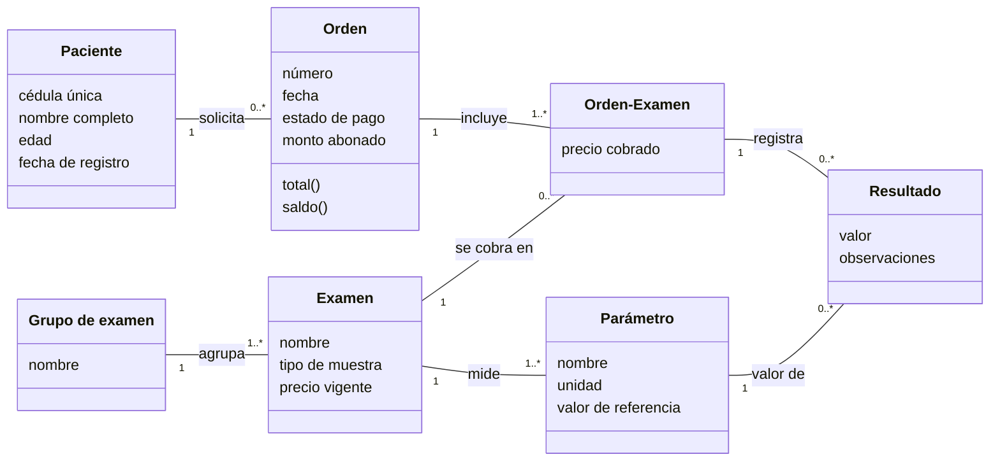

# Modelo de dominio de BioLab (FPI-09)

Diagrama de clases conceptual del MVP. Cada entidad sale de un requisito validado en la FPI-08.

## Reglas de negocio

| Regla | Descripción | Prueba |
|---|---|---|
| RN-01 | La cédula es única y solo contiene números; la edad está entre 0 y 120. | `test_cedula_duplicada`, `test_cedula_solo_numeros`, `test_edad_fuera_de_rango` |
| RN-02 | Una orden necesita un paciente y al menos un examen; un examen no se repite en la misma orden. | `test_orden_sin_paciente_no_se_crea`, `test_orden_sin_examenes_no_se_crea`, `test_examen_repetido_cuenta_una_vez` |
| RN-03 | El precio de cada examen queda fijo en la orden al crearla. | `test_precio_queda_fijo_en_la_orden` |
| RN-04 | Total = suma de precios cobrados; saldo = total − abonos; un abono es mayor que 0 y no supera el saldo; el estado de pago se calcula. | `test_abono_parcial`, `test_abono_mayor_al_saldo_se_rechaza`, `test_pago_completo` |
| RN-05 | Un reporte de resultados no se marca como entregado si falta algún resultado. | Por escribir (HU-05) |
